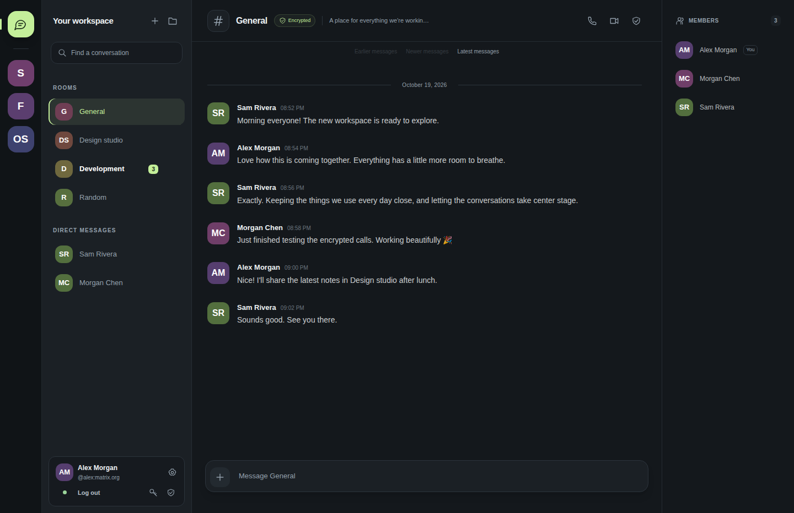

# Grungus

A Discord-style desktop chat client for the [Matrix](https://matrix.org)
network — the same open, federated protocol that
[Element](https://element.io) runs on. Point it at any homeserver
(matrix.org, a self-hosted Synapse, conduwuit, dendrite, …) and chat in a
familiar, Discord-like UI.

Not affiliated with Discord or Element. Grungus is an independent client
for an open protocol.



## Features

- **Matrix login** — password or access-token, with
  `.well-known/matrix/client` homeserver discovery, exactly like Element.
- **End-to-end encryption (Olm/Megolm)** — messages in encrypted rooms
  are megolm-encrypted via libolm (WASM); room keys are shared over olm
  to-device messages to every member device, including your own.
  Encrypted rooms show a 🔒 badge; sends fail closed rather than leaking
  plaintext (including sends that race the first room sync);
  undecryptable events show an explicit notice while the key is
  requested from other devices.
- **Room key forwarding (m.room_key_request / m.forwarded_room_key)** —
  a fresh device asks your other devices (and SAS-verified members)
  for the megolm sessions behind "unable to decrypt" history; the
  exported session is imported at its chain index and the affected
  messages decrypt in place, live. Unverified strangers are declined.
- **Key rotation on membership change** — when someone joins or leaves
  an encrypted room, senders start a fresh megolm session: joiners can
  read from their join onward (not before, unless verified — see
  forwarding), and leavers cannot read the room's future.
- **Invites** — rooms you are invited to (rooms.invite in /sync) appear
  in an "Invites" section with accept/decline buttons; accepting joins
  and immediately enables chat.
- **Native group calls (MSC3401, full-mesh WebRTC)** — start or join a
  call from the chat header; m.call.member state announces membership,
  SDP offers/answers and ICE candidates flow over olm-encrypted
  (encrypted rooms) or plaintext to-device messages, media rides
  WebRTC DTLS-SRTP with one peer connection per member device. Mute,
  hang up, per-peer connection state. When no capture devices exist,
  a synthetic canvas/oscillator stream keeps calls working (with a
  visible notice) — handy on headless hosts.
- **Discord-style layout** — space rail (servers), room/channel list,
  chat with grouped messages and day dividers, member list, composer.
- **Spaces as servers** — Matrix Spaces appear in the left rail like
  Discord servers; their child rooms become the "channels".
- **Direct messages** — unnamed 1:1 rooms resolve as DMs, named after
  the other member.
- **Real-time sync** — `/sync` long-polling with exponential backoff and
  a connection indicator; messages arrive live.
- **Local echo** — sent messages render instantly, then reconcile with
  the server event (no duplicates, "failed to send" marking on errors).
- **Images and GIFs** — `m.image` / `m.sticker` messages render inline
  via authenticated media downloads; GIFs animate natively. The composer
  📎 button uploads and sends images (`m.image`).
- **Typing notifications** — the composer emits `m.typing` while you
  type (server-rate-limited); other members' typing state shows above
  the composer.
- **Device verification (SAS)** — the 🛡 button in encrypted rooms
  starts emoji-based SAS verification (m.key.verification, real libolm
  SAS + HKDF MACs) with every other member's unverified device; both
  sides see the same emoji, confirming marks the device's Ed25519 key
  trusted.
- **Unread badges** — per-room counters, cleared when you open the room.
- **Room creation** — inline "new room" form in the sidebar.
- **Strict TypeScript throughout** — typed Matrix event/sync shapes and
  a typed client event bus; `tsc --noEmit` is the CI lint gate. The only
  runtime dependency is Electron itself.

## Architecture

```
┌──────────────────────────────────────────────────────────────┐
│ Electron main process   src/main/   →  dist/main.cjs         │
│   window lifecycle, session + crypto vaults (safeStorage), IPC │
└───────────────┬──────────────────────────────────────────────┘
                │ contextBridge (contextIsolation, sandbox on)
┌───────────────┴──────────────────────────────────────────────┐
│ Renderer                 src/renderer/ → dist/renderer.js     │
│                                                               │
│   app.ts ── orchestrates state and wiring                     │
│     ├── services/matrix-client.ts  typed Matrix CS API client │
│     ├── services/e2ee.ts           Olm/Megolm via libolm WASM │
│     ├── services/calls.ts          MSC3401 calls, mesh WebRTC │
│     └── components/*.ts             custom elements:           │
│           login-view, app-shell, space-rail, room-list,        │
│           chat-view, message-item, member-list, g-avatar       │
└──────────────────────────────────────────────────────────────┘
```

- **esbuild** produces three outputs in `dist/`: the main process and
  preload (CJS, `.cjs` because package.json is `type: module`) and the
  renderer as ONE classic-script IIFE. A bundle is required: Chromium and
  Electron block ES modules loaded from `file://` (CORS). libolm's
  universal wrapper needs fs/path/crypto shims when bundling for the
  browser (handled in scripts/build.mjs), and `olm.wasm` ships in `dist/`.
- **Strict TypeScript end to end**: typed Matrix event/sync wire shapes,
  a typed client event bus, a timeline item union
  (`MessageItem | SystemItem`), and `HTMLElementTagNameMap` entries so
  `document.createElement("chat-view")` returns the right element class.
- **Tests and examples run the .ts sources directly** on Node ≥ 24 via
  native type stripping — no separate build for the test suite.
- No framework: native custom elements, one stylesheet.
- The session and the E2EE identity pickles are stored encrypted via
  Electron's `safeStorage` when the platform keychain is available.
- CSP: scripts and styles only from the app plus `'wasm-unsafe-eval'`
  (WebAssembly for libolm, without allowing `eval()`); `connect-src *`
  because the homeserver URL is user-configured.

## Matrix protocol coverage

Grungus implements a dependency-free subset of the Matrix
Client-Server API (v3 paths, spec v1.x):

| Purpose | Endpoint |
|---|---|
| Homeserver discovery | `GET /.well-known/matrix/client` |
| Feature negotiation | `GET /_matrix/client/versions` |
| Login | `POST /_matrix/client/v3/login` (m.login.password) |
| Token check | `GET /_matrix/client/v3/account/whoami` |
| Profile | `GET /_matrix/client/v3/profile/{userId}` |
| Realtime | `GET /_matrix/client/v3/sync` (long-poll, incl. to-device) |
| Send message | `PUT …/send/{m.room.message \| m.room.encrypted}/{txnId}` |
| Room creation | `POST /_matrix/client/v3/createRoom` (incl. spaces, encryption) |
| Join / invite | `POST /join/{idOrAlias}`, `POST /rooms/{id}/invite` |
| Logout | `POST /_matrix/client/v3/logout` |
| Device keys | `POST /keys/upload`, `POST /keys/query`, `POST /keys/claim` |
| Room key sharing | `PUT /sendToDevice/m.room.encrypted/{txnId}` (olm) |
| Avatars / media | `GET /_matrix/media/v3/{thumbnail,download}/…` (Bearer) |
| Calls (MSC3401) | `m.call.member` state; `m.call.negotiate` / `m.call.candidates` to-device (olm in encrypted rooms, plaintext otherwise) |

Room state (names, topics, members, spaces, encryption) is derived from
`m.room.*` state events in the sync response, following the same model
Element uses. Device keys are signed with canonical JSON (Ed25519), the
same way Element signs them.

## Getting started

```bash
npm install
npm start        # build + launch the desktop app
```

Log in with your Matrix credentials (e.g. `matrix.org` + username +
password), or with an access token from Element: Settings → Help & About.

Other scripts:

```bash
npm run build      # esbuild -> dist/
npm run typecheck  # tsc --noEmit (strict)
npm test           # client + E2EE suites vs the in-repo mock homeserver
npm run smoke      # build + boot the app, then exit (--smoke)
```

### Web demo mode

The renderer bundle is plain web tech and `dist/` is self-contained, so
you can serve it without Electron:

```bash
npm run build
cd dist && python3 -m http.server 8080
# open http://localhost:8080
```

In this mode the session and E2EE pickles are stored in `localStorage`
(fine for testing, use the desktop app for day-to-day).

## Security notes

- Renderer runs with `contextIsolation`, `sandbox`, no Node access;
  the only bridge is a small `grungusPlatform` API (session + crypto vaults).
- Access tokens and olm identity pickles are stored via `safeStorage`
  (OS keychain) where available; the fallback plaintext file is written
  `0600` in the Electron user data directory and is documented here as a
  known trade-off. In browser dev mode pickles live in `localStorage`.
- **E2EE is trust-on-first-use (v1)**: device keys are not verified (no
  SAS/QR verification UI, no cross-signing), there is no key backup and
  no key forwarding — a new device cannot decrypt history that predates
  it, and outbound sessions are not rotated on membership change. Treat
  it as protection against the server, not against device substitution.
- Sends fail closed: an encrypted room without a working E2EE layer never
  receives plaintext.
- **Calls**: signaling is olm-encrypted inside encrypted rooms; media is
  WebRTC DTLS-SRTP, and in a full mesh there is no middleman. New rooms
  are created with `m.call.member` permitted at power level 0 (the same
  grant Element Call uses); in legacy rooms with restrictive power
  levels, joining members cannot publish call state.
- Messages render as text only; HTML from other clients is not executed.
- Media is fetched with authenticated requests (Bearer header) and
  rendered from blob object URLs — compatible with homeservers that
  require authenticated media (e.g. matrix.org).

## Testing

Four layers, all driving the same typed client modules that ship in the app:

1. **Typecheck** — `npm run typecheck` (`tsc --noEmit`, strict, across
   src/tests/examples).
2. **Integration tests vs an in-repo mock homeserver** — `npm test`
   (login, sync, bidirectional messages, local echo, unread, DM
   resolution, spaces, media metadata, auth-error handling, E2EE: key
   upload, encrypted round-trips both ways with real libolm identities,
   plaintext-rooms regression).
3. **Real-homeserver e2e** — `tests/e2e-real-homeserver.ts` (run manually
   against conduwuit/Synapse/matrix.org-style servers; exercises UIA
   registration, real sync, real state events, authenticated media, and
   a full E2EE round-trip including a server-side check that stored
   events are opaque megolm ciphertext). See the header of that file for
   the env vars.
4. **CI** — typecheck + tests + an Electron boot smoke test
   (`electron . --smoke` under xvfb on ubuntu-latest).

The E2EE layer has also been verified in a real browser against a real
homeserver: bidirectional encrypted chat with a headless second device,
sender self-visibility, and correct "unable to decrypt" notices for
history predating the device.

Calls are verified in layers: signaling suites (member state visibility,
plaintext signals, olm-encrypted signals — all in `npm test`), the
real-homeserver e2e (membership publish/clear), and a live two-party
call in a real browser against the real homeserver — full mesh
established, `connectionState: connected` on both peers, two media
tracks delivered and the video decoding over DTLS-SRTP, hangup via the
product UI.

Typing notifications, composer media sending, and SAS device
verification are each verified twice: a mock-homeserver suite in
`npm test` (typing round-trip; upload/send/receive/download byte
equality; full SAS handshake with identical emoji, mutual device-trust
marking, and a forged-MAC rejection) and the real-homeserver e2e
(typing over conduwuit; a megolm-wrapped `m.image` event decrypted by
the peer with an authenticated media fetch; SAS against a second real
device). The SAS UI path — verify button, emoji comparison card,
"They match" confirmation — was additionally driven live in the
browser against a real second device.

Key forwarding, rotation, and invites are verified the same way:
mock suites (a second device of the same user decrypts history; an
unverified stranger is declined; a SAS-verified member gets history
after joining; joiners read post-join but not pre-join messages;
leavers cannot read future messages; invite appear/accept/decline),
the real-homeserver e2e (rotation and invites over conduwuit; a fresh
login of the same user receiving history via a forwarded key), and
live in the browser: a fresh device's "unable to decrypt" lines in a
room with real history turned into the decrypted messages in place,
and an invite card was accepted through the UI with messages flowing
immediately after. One real bug class was found and fixed during this
verification: a send racing the first sync of a room used to leak
plaintext into encrypted rooms — createRoom/joinRoom now carry the
encryption flag and unknown-room sends fail closed.

Small CLI tools in `examples/` (list-rooms, tail-room, send-message) use
the same client from Node — handy for debugging and demos.

## Roadmap

- **Calls hardening** — an SFU for larger rooms (full mesh scales to a
  handful of participants), screenshare, Element Call interoperability
  (the signaling is modeled on MSC3401 but interop is untested), and
  insertable-streams E2EE media on top of DTLS-SRTP.
- **E2EE hardening** — QR device verification, cross-signing, key
  backup. (SAS verification, key forwarding to own/verified devices,
  and rotation on membership change shipped — see above; verification
  persistence is per-device-store only.)
- Space management UI, message
  editing/reactions, reply chains.
- Server-side read markers, presence, notifications
  (Electron + Push Gateway).

## License

MIT — see [LICENSE](LICENSE).
